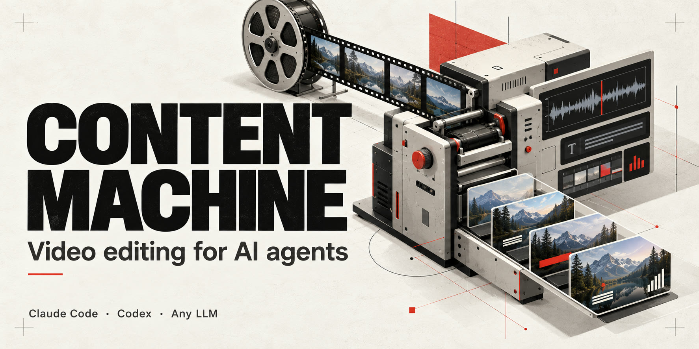
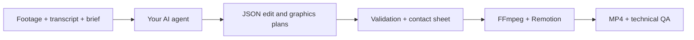

<p align="center">
  
</p>

<h1 align="center">Content Machine</h1>
<p align="center"><strong>A local video-editing engine for Claude Code, Codex, and other AI agents.</strong></p>
<p align="center">Real footage in. A readable edit plan. FFmpeg and Remotion out.</p>
<p align="center">
  <a href="#quick-start">Quick start</a> · <a href="docs/getting-started.md">Installation</a> ·
  <a href="docs/agent-workflow.md">Agent workflow</a> · <a href="docs/SHORTS.md">Shorts</a> ·
  <a href="CONTRIBUTING.md">Contribute</a> · <a href="README.it.md">Italiano</a>
</p>

Give your coding agent a video, a transcript, and a brief. It writes an explicit JSON plan; the engine handles rendering, portrait crops, subtitles, motion graphics, audio, and export.

**Use the agent you already have.** The package does not require an LLM API key, cloud account, hosted dashboard, or a specific model provider. Claude Code and Codex skill entrypoints are included. Any other agent that can read files and run commands can use the same workflow.

## See the native renderer


*Actual output from the native Remotion components on a synthetic background. A component demonstration, not customer footage or a one-click editing benchmark. [Plan and reproduction notes →](examples/README.md)*

## What you can build

| Workflow | What the engine does |
| --- | --- |
| **Captioned vertical shorts** | Resolves transcript indices, reframes to portrait, renders ASS subtitles with word highlighting, and exports clips. |
| **Motion graphics over footage** | 23 native long-form overlay types: cards, lists, steps, comparisons, charts, chat bubbles, and more. |
| **Short-form overlays** | 8 native overlay types, composed with transparency over the original clip. |
| **Precise revisions** | Per-clip crop corrections and internal cuts; retained words and effects are rebased onto the edited timeline. |
| **Reviewable production** | JSON plans, contact sheets, versioned render blocks, synthetic sound effects, technical QA, and MP4 export. |

The **agent makes editorial decisions**. The code validates and executes them. A transcript is data, not a source of instructions; numbers and claims must come from the footage or the user's brief.

## Quick start

Prerequisites: **Python 3.12**, **Node 22 or 24**, **FFmpeg + FFprobe** with libx264/libass, and an existing **Chrome, Chromium, or Edge** installation. Keep the clone and video workspace on a drive with enough free space.

```sh
git clone https://github.com/giuseppedellipaoli/content-machine.git
cd content-machine
```

<details open>
<summary><strong>Windows / PowerShell</strong></summary>

```powershell
./setup.ps1
Copy-Item .env.example .env
# Set your own tool paths in .env if they are not already in PATH.
./.venv/Scripts/python.exe tools/content_machine.py doctor
```

</details>

<details>
<summary><strong>Linux / macOS</strong></summary>

```sh
python3.12 -m venv .venv
.venv/bin/python -m pip install -r requirements.lock.txt
cd motore/video-gfx && npm ci && cd ../..
cp .env.example .env
.venv/bin/python tools/content_machine.py doctor
```

The clean-install render was verified on Windows. Linux and macOS have not yet been verified end to end; contributions are welcome.

</details>

### Give your agent this prompt

```text
Read AGENTS.md and skills/content-machine/SKILL.md.
Use this repository to edit my video at /path/to/video.mp4.
My transcript is /path/to/transcript.srt.
Create a new job under work/jobs/, follow my brief, prepare a readable
JSON plan, inspect a contact sheet, and render a verified MP4.
Use only the assets I provide. Preserve the original footage.
```

Your agent can also start from the CLI. Use the Python interpreter in this clone's virtual environment:

```sh
python tools/content_machine.py prepare /path/to/video.mp4 \
  --job work/jobs/first-edit \
  --srt /path/to/transcript.srt \
  --prompt "Make a clear edit with motion graphics that match the spoken content."
```

After the agent writes and validates the long-form plan:

```sh
python tools/content_machine.py render-long --job work/jobs/first-edit
```

Output: `work/jobs/first-edit/export/video.mp4`. For portrait clips, follow the [native shorts workflow](docs/SHORTS.md).

## How it works



The original orchestration modules can exchange **request/response JSON files** with your agent. A request contains instructions, input, a schema, and a hash. The agent writes a matching response; the script validates it and continues. No provider SDK or background LLM API call is involved. [Read the contract →](docs/agent-workflow.md#provider-independent-json-exchange)

## Capabilities and current limits

- **Transcripts:** word-timed JSON, imported SRT, or optional local faster-whisper. SRT only provides cue timings; imported word timings are explicitly marked as estimates.
- **Long-form:** preserves the normalized source timeline and adds motion graphics and audio effects. Additional cuts, B-roll, music, or long-form subtitle compositing require an explicit agent-authored composition.
- **Shorts:** native portrait editing, internal cuts, karaoke subtitles, optional face-aware crop, and overlay composition. Without the optional face model, the crop falls back to the center and should be reviewed.
- **Assets:** bring footage, music, fonts, and inserts you have the right to use. This repository does not search for stock, generate video from text, or publish to social networks.
- **Local transcription:** optional and not certified on the tested Windows machine because the OS blocked a CTranslate2 library. The SRT/JSON path was tested successfully.

## Verified, with the scope stated

A fresh tracked-files-only copy was installed into a new Python environment with new Node dependencies. The complete synthetic long-form export produced **1920×1080 H.264/AAC at 30 fps, 18.000 seconds, with a 100/100 technical QA score**. A separate native short rendered at **1080×1920 / 30 fps** with ASS subtitles. These are technical checks, not a promise of editorial quality on arbitrary footage.

The original quick suites, timing conversions, offline JSON exchange, and TypeScript checks were exercised. Optional font/model tests reported explicit skips. [Verification report →](docs/VERIFICA.md)

## Project map

```text
skills/content-machine/     Shared agent workflow
.agents/skills/             Codex-compatible skill entrypoint
.claude/skills/             Claude Code skill entrypoint
tools/                      Workspace, checks, and demo commands
motore/shorts-pipeline/     FFmpeg editing, captions, cuts, and QA
motore/video-gfx/           React/Remotion components and rendering
motore/orchestratore/      Schemas, prompts, and offline JSON exchange
examples/                   Public synthetic demonstration plan
work/                       Your local jobs and outputs — ignored by Git
```

## Contribute

Useful contributions include reproducible rendering fixes, Linux/macOS verification, example plans, subtitle timing improvements, and component previews. Start with [CONTRIBUTING.md](CONTRIBUTING.md), or open a focused [bug report or feature request](https://github.com/giuseppedellipaoli/content-machine/issues/new/choose).

If you find the engine useful, **star the repository** and share what you built. Real examples and reproducible reports help the project improve.

## License and provenance

Project code is **[MIT licensed](LICENSE)**. FFmpeg, Remotion, models, fonts, and other dependencies retain their own terms. **Remotion has a separate license and is not covered by this repository's MIT license.** No paid license is purchased by setup. See [third-party notices](THIRD_PARTY_NOTICES.md).

Extracted from an existing video codebase, with personal services, accounts, client media, and original Git history excluded. [Provenance](docs/ORIGINE.md) · [Artwork and demo provenance](assets/README.md).
